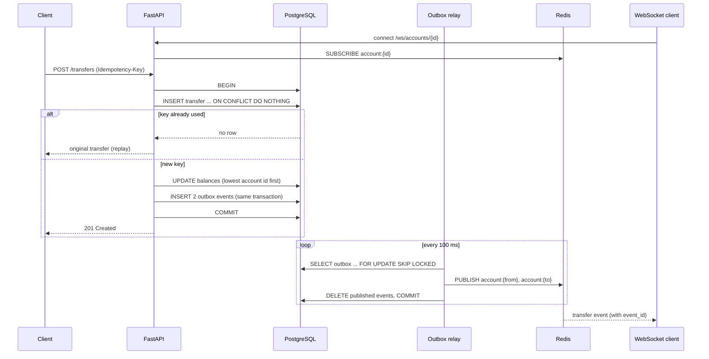
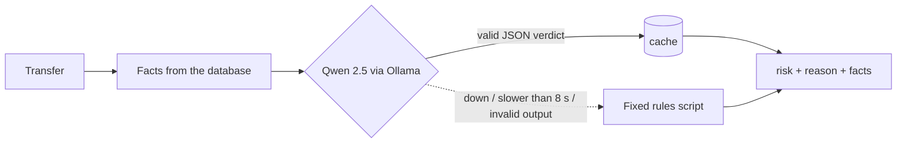

# ledger-service

[](https://github.com/amanuel1271/ledger-service/actions/workflows/ci.yml)


A small payments ledger API. Accounts hold balances; deposits, withdrawals and transfers move money; every change is recorded in a ledger you can page through; and clients can watch an account live over a WebSocket.

It is built to get five things right under concurrency and failure:

- **No double charges.** Every transfer needs an `Idempotency-Key`. Retrying with the same key returns the original transfer instead of moving money again.
- **No overdrafts.** A balance can never go below zero, even with hundreds of transfers hitting the same account at once.
- **No deadlocks.** Two transfers going in opposite directions (A→B and B→A) can't lock each other up.
- **The books always balance.** Every balance change writes a ledger entry in the same transaction, so an account's balance always equals the sum of its entries. A test checks this after hundreds of concurrent operations.
- **No lost events.** Every committed transfer's live event is delivered, even if Redis is down or the process crashes right after the commit (transactional outbox).

## How it works



The database does the safety work, not application code:

| Rule | Enforced by |
|---|---|
| One transfer per idempotency key | `UNIQUE (idempotency_key)`. A concurrent duplicate waits on the index, then replays. |
| Balance never negative | `CHECK (balance >= 0)`. An overdraft rolls back the whole transfer. |
| No deadlocks | Both balance updates run in account-id order. |
| Amounts are exact | Integer cents (`BIGINT`), never floats. |
| Balance = sum of ledger entries | Every change (opening, deposit, withdrawal, transfer in/out) inserts an `entries` row in the same transaction as the balance update. |
| A committed transfer always gets its events | Events go into an `outbox` table in the **same transaction** as the transfer. A rolled-back transfer leaves no events. |
| Events survive a Redis outage | The relay deletes events only after publishing them. If publishing fails, the transaction rolls back and the events are retried. |

## AI risk review

`GET /transfers/{id}/risk` gives a second opinion on a transfer. It is **advisory only**: it never blocks, delays or changes a payment, because a language model must not decide whether money moves.



1. **Facts come from SQL, not from the model:** the amount, the sender's account age, transfers in the previous 10 minutes, the sender's usual amount, whether the recipient is new, and the share of the balance moved. All are measured as of the transfer, so the answer doesn't drift.
2. **A local Qwen model** judges the facts. It runs on your machine through [Ollama](https://ollama.com): no API key, and no data leaves the host.
3. **If the model is unavailable, slow, or returns anything invalid**, a fixed rules script scores the same facts. The response says which one answered (`"engine": "qwen"` or `"rules"`).
4. Model verdicts are cached per transfer. Rules verdicts are not, so the model gets another chance next time.

```json
{
  "risk": "high",
  "reason": "amount is 593x the sender's usual; 6 transfers in the previous 10 minutes; moves 100% of the balance; sender account is under an hour old",
  "engine": "rules",
  "facts": {"amount": 99000, "sender_account_age_s": 0, "sender_transfers_last_10m": 6,
            "sender_avg_amount": 167, "first_time_recipient": false, "share_of_balance": 1.0}
}
```

The response always includes the `facts`, so a person can check the model's reasoning against them. A small model can get the level right and still describe it loosely.

To turn the model on: `ollama pull qwen2.5:3b`. Without it, everything works on the rules path (that is what CI runs).

## API

| Method | Path | Description |
|---|---|---|
| `POST` | `/accounts` | Create an account: `{"owner": "alice", "opening_balance": 10000}` |
| `GET` | `/accounts/{id}` | Get an account and its balance |
| `POST` | `/transfers` | Move money: `{"from_id": 1, "to_id": 2, "amount": 2500}` with header `Idempotency-Key` |
| `POST` | `/accounts/{id}/deposits` | Add money: `{"amount": 5000}` with header `Idempotency-Key` |
| `POST` | `/accounts/{id}/withdrawals` | Take money out: `{"amount": 1000}` with header `Idempotency-Key`. Fails with `422` rather than overdraw. |
| `GET` | `/transfers/{id}/risk` | Advisory fraud-risk review: `{risk, reason, engine, facts}`. Never blocks a transfer. |
| `GET` | `/accounts/{id}/transactions?limit=50&cursor=` | Ledger history, newest first. Pass `next_cursor` back to get the next page. |
| `WS` | `/ws/accounts/{id}` | Stream transfer events for an account |
| `GET` | `/health` | Liveness and dependencies: `200 ok`, `200 degraded` (Redis or relay down), `503 down` (Postgres down) |
| `GET` | `/metrics` | Prometheus metrics (see Observability) |

| Status | Meaning |
|---|---|
| `201` | Transfer created, or replayed for a key that was already used |
| `404` | Account not found |
| `409` | Idempotency key reused with a different request body |
| `422` | Insufficient funds, invalid amount, or same source and destination |

Interactive docs are at `http://localhost:8000/docs` once it's running.

## Run it

```bash
docker compose up --build
```

```bash
curl -X POST localhost:8000/accounts -H 'Content-Type: application/json' -d '{"owner":"alice","opening_balance":10000}'
curl -X POST localhost:8000/accounts -H 'Content-Type: application/json' -d '{"owner":"bob"}'
curl -X POST localhost:8000/transfers -H 'Content-Type: application/json' \
     -H 'Idempotency-Key: order-42' -d '{"from_id":1,"to_id":2,"amount":2500}'
```

## Observability

`GET /health` checks Postgres, Redis and the outbox relay, and reports the outbox backlog:

```json
{"status": "ok", "checks": {"database": "ok", "redis": "ok", "outbox_relay": "ok", "outbox_backlog": 0}}
```

| Status | When | Why |
|---|---|---|
| `200 ok` | everything up | |
| `200 degraded` | Redis or the relay is down | Transfers still commit; their events wait in the outbox and go out when Redis is back, so the service is still useful |
| `503 down` | Postgres is down | Nothing can be read or written |

`GET /metrics` exposes Prometheus metrics:

| Metric | Type | What it tells you |
|---|---|---|
| `http_requests_total{method,route,status}` | counter | Traffic and error rate per endpoint |
| `http_request_duration_seconds{method,route}` | histogram | Latency (p50/p95/p99 via `histogram_quantile`) |
| `ledger_transfers_total{outcome}` | counter | `created`, `replayed`, `insufficient_funds`, `not_found`, `conflict`, `invalid` |
| `ledger_outbox_published_total` | counter | Events delivered to Redis |
| `ledger_outbox_backlog` | gauge | Events waiting; a growing value means Redis or the relay is stuck |

Labels use route templates (`/accounts/{account_id}`), never raw paths, so the number of time series stays bounded.

## Performance

`loadtest.py` fires concurrent transfers at a running service, then checks that the total money across all accounts is unchanged and every request returned `201`. It exits non-zero otherwise, and CI runs a small version on every push.

```bash
docker compose up -d --build
python loadtest.py --requests 10000 --concurrency 10          # spread over 100 accounts
python loadtest.py --requests 10000 --concurrency 10 --hot    # every transfer debits the same account
```

Results on a laptop (Docker Desktop, 4 CPUs shared by Postgres, the API and the load generator; one uvicorn worker; 10,000 transfers per run):

| Scenario | Concurrency | Throughput | p50 | p95 | p99 | Errors | Money conserved |
|---|---|---|---|---|---|---|---|
| Spread over 100 accounts | 10 | 1,372 transfers/s | 5.1 ms | 19.7 ms | 35.7 ms | 0 | yes |
| Hot account (all debit #1) | 10 | 1,181 transfers/s | 6.2 ms | 22.2 ms | 33.4 ms | 0 | yes |

What the test showed:

- **Pool size was the first limit.** With the default 10 database connections, 50 concurrent clients queued for a connection and throughput fell to about 460/s. The pool is now 20 by default (`DB_POOL_SIZE`). Higher values didn't help further.
- **A hot account costs about 14%, not more.** Every transfer row-locks account #1, but each transaction holds the lock for only a few milliseconds, so they line up quickly.
- **At 50+ concurrent requests the load generator is the limit, not the service.** A single Python client process uses about 90% of a core and results become noisy (roughly 500 to 870/s). To push harder, run several `loadtest.py` processes or a dedicated tool. A single uvicorn worker is also a ceiling; more workers behind the same Postgres is the next step.

## Tests

The tests run against real PostgreSQL and Redis, the same way CI does:

```bash
docker compose up -d postgres redis
docker compose run --rm api pytest -q
```

They cover health states (ok / degraded when Redis is down / 503 when Postgres is down), transfer-outcome metrics, bounded metric labels, a normal transfer, idempotent retries, a reused key with a different body, overdraft rejection, 200 concurrent transfers in both directions (money conserved, no deadlock), live WebSocket events, events surviving a Redis outage (the relay recovers on its own), a rejected transfer leaving no events, deposits and withdrawals (idempotent, overdraft-proof), balance always equal to the ledger after concurrent operations, history pages covering every entry exactly once, and the risk review (rule thresholds, model verdict used and cached, invalid model output rejected, money never touched).

## Trade-offs

- Events are delivered **at least once**. If the relay crashes after publishing but before deleting, a few events can be sent again. Each event has an `event_id`, so clients can drop duplicates.
- The relay checks the outbox every 100 ms, so live events can lag a transfer by up to about 0.1 s. Postgres `LISTEN/NOTIFY` would cut that if it ever matters.
- With several app instances, each runs a relay. `SKIP LOCKED` stops them from sending the same event twice, but events for one account can then arrive out of order. Order by `event_id` if that matters.
- The risk review is a second opinion, not a fraud system: six simple facts and a small local model. Its value here is the pattern (model with a deterministic fallback, validated output, never in the payment path).
- History uses **keyset (cursor) pagination** (`WHERE id < cursor ORDER BY id DESC`) instead of `OFFSET`. Pages stay stable while new entries arrive, and deep pages are as fast as the first.
- Idempotency keys are unique per operation type: transfers and deposits/withdrawals keep their keys in separate tables.
